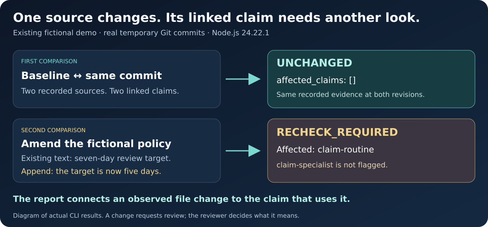

# RegNav Source Watch

**See which documented claims need another look when their recorded evidence changes.**

RegNav Source Watch is a GitHub Action and local command-line tool for research,
policy and governance records maintained in Git. It compares an evidence manifest
and its tracked source files at two commits, then identifies the affected claims.
Reports preserve the declared supporting, qualifying, contradicting and contextual
relationships so a reviewer can see why a record needs attention.

The implementation uses Node.js 24 and its built-in libraries. It makes no network
or model calls, needs no service account or API key, and reads source bytes from
committed Git objects. The Action writes a job summary and a local JSON report.

## See it in action



Supply the [two-source fictional example](examples/basic). The existing demo
creates temporary Git commits, compares the baseline with itself, then appends
a five-day amendment to the policy's seven-day review target. The observed
results are **`UNCHANGED` → `RECHECK_REQUIRED`**, with only
**`claim-routine`** flagged after that source change.

From the repository folder, with Git and Node.js 24 installed:

```sh
npm run demo
```

[Read the captured command output](docs/demo/observed-session.txt) ·
[Inspect the demo script](scripts/demo.mjs) ·
[Follow the full walkthrough](#try-the-fictional-demonstration)

The diagram illustrates the real CLI results. Temporary commit identifiers vary
by run; the unchanged referral source leaves `claim-specialist` unaffected.

## What a change tells you

Suppose a research record links `claim-routine` to a saved policy containing a
seven-day review target. Someone changes the source to ten days. Source Watch
identifies the changed file and the linked claim, with the before and after
fingerprints and the recorded review information.

That observation gives the reviewer a concrete task: reconsider the claim against
the new source. Substantive interpretation remains with the reviewer. A source
fingerprint identifies bytes; a stored reviewer name records a declaration.

| Result | Meaning |
| --- | --- |
| `UNCHANGED` | No substantive differences or missing tracked sources were found in this comparison. Review-record edits are reported separately. |
| `RECHECK_REQUIRED` | A source, claim or evidence relationship changed, or a tracked source could not be observed. |
| `INVALID` | The inputs, available commits or supported file types do not permit a valid comparison. |

An unchanged result concerns the specified records at these two commits. It does
not establish source authenticity, current law, factual accuracy, complete evidence
coverage or the quality of any earlier review.

## Try the fictional demonstration

With Git and Node.js 24 installed:

```sh
git clone https://github.com/Albertito-AI/regnav-source-watch.git
cd regnav-source-watch
npm test
npm run demo
```

The demo creates a temporary Git repository from the [fictional example](examples/basic),
compares unchanged snapshots, changes a source, and runs another comparison.
Expect both `UNCHANGED` and `RECHECK_REQUIRED`. All names, sources, propositions
and reviewer details in this example are synthetic.

## Add it to a repository

### 1. Commit the evidence manifest and source files

Start with [examples/basic/.regnav/manifest.json](examples/basic/.regnav/manifest.json)
and the accompanying `sources/` files in a new test repository. Source paths are
relative to the repository root. Replace the fictional records with your own
permitted material when you are ready.

**Commit the initial manifest before enabling the Action.** Both the base and head
commits must contain a valid manifest. The Action fails with `INVALID` if an initial
manifest is absent; it never invents a baseline or silently checks only one side.

See the [manifest reference](docs/manifest.md) for the complete format and limits.

### 2. Add a pull-request workflow

Save this as `.github/workflows/source-watch.yml`:

```yaml
name: Source review

on:
  pull_request:

permissions:
  contents: read

jobs:
  source-watch:
    runs-on: ubuntu-latest
    steps:
      - uses: actions/checkout@d23441a48e516b6c34aea4fa41551a30e30af803
        with:
          fetch-depth: 0
          persist-credentials: false
      - name: Find affected claims
        id: source-watch
        uses: Albertito-AI/regnav-source-watch@5e9d6a897dc96685347114b9c1abce14807f9d16 # v0.1.0
        with:
          manifest: .regnav/manifest.json
          mode: advisory
```

This example pins the exact released commit rather than a mutable tag. Before
upgrading, inspect the [v0.1.0 release](https://github.com/Albertito-AI/regnav-source-watch/releases/tag/v0.1.0),
review the replacement commit and update the pin deliberately. Use a GitHub-hosted
runner for untrusted pull requests. See [SECURITY.md](SECURITY.md) for the
execution boundary and baseline protection.

### 3. Inspect the workflow summary

Open the completed workflow job to read its summary. The Action also exposes the
absolute path to `report.json` for a later step. It does not automatically upload
that report or post a pull-request comment. The report may contain claim text,
source paths and declared reviewer details, so apply your repository's normal
access policy before retaining or sharing it.

## Action inputs and outputs

| Input | Default | Purpose |
| --- | --- | --- |
| `manifest` | `.regnav/manifest.json` | Repository-relative path to the manifest at both commits. |
| `mode` | `advisory` | `advisory` reports changes; `strict` also fails when review is required. Invalid comparisons always fail. |
| `base-sha` | Event-derived for `pull_request` and `push` | Full base commit SHA. Required for other supported event contexts. |
| `head-sha` | Event-derived for `pull_request` and `push` | Full head commit SHA. Required for other supported event contexts. |

Explicit commit inputs on pull-request and push events must match the event's
commits. Both objects must already be available in the checkout. New-branch pushes
with an all-zero previous SHA require a separately configured comparison; a zero
SHA is rejected. `pull_request_target` is rejected.

| Output | Value |
| --- | --- |
| `verdict` | `UNCHANGED`, `RECHECK_REQUIRED` or `INVALID`. |
| `report-path` | Absolute path to the generated JSON report. |
| `summary-path` | Absolute path to the generated Markdown summary. |
| `affected-count` | Number of affected claims. |

### Choosing a mode

Begin with `advisory` while you learn how the findings fit your review process.
`strict` fails whenever tracked substantive differences or missing sources remain
in the comparison. Editing a review declaration does not clear that result. This
version has no authenticated approval or waiver mechanism, so make it a required
merge check only if that behaviour matches your intended policy.

## Local comparison

```sh
node src/cli.mjs \
  --repo /path/to/repository \
  --base FULL_BASE_COMMIT_SHA \
  --head FULL_HEAD_COMMIT_SHA \
  --manifest .regnav/manifest.json \
  --mode advisory \
  --output /path/to/new-report-directory
```

Use a new output directory under an existing parent. The command writes
`report.json` and `summary.md`; existing output directories are refused. All inputs are read from the named Git
commits, so uncommitted workspace edits do not enter the comparison.

| Condition | Advisory exit | Strict exit |
| --- | --- | --- |
| `UNCHANGED` | 0 | 0 |
| `RECHECK_REQUIRED` | 0 | 2 |
| `INVALID` | 1 | 1 |

## Comparison rules

- Changed source bytes, source metadata, added or removed sources and missing
  source files are reported.
- New, removed or altered claims and changed evidence links require review.
- Dependencies from both commits are considered, so removing a link cannot hide
  the impact of a source change on the earlier record.
- Review-declaration edits are visible separately. They never erase a source or
  claim finding.
- Reordering sources, claims or evidence links has no substantive effect.

Only the sources and links explicitly declared in the manifest are covered. A
remote website may change while its saved local copy remains identical. The tool
does not retrieve websites, discover new authorities or decide whether a source
supports a proposition. Full boundaries are in [docs/limitations.md](docs/limitations.md).

## Documentation and support

- [Manifest format](docs/manifest.md)
- [Interpretation and limitations](docs/limitations.md)
- [Security policy](SECURITY.md) and [privacy](PRIVACY.md)
- [Support](SUPPORT.md), [contributing](CONTRIBUTING.md) and [changes](CHANGELOG.md)

For a reproducible bug, open an [issue](https://github.com/Albertito-AI/regnav-source-watch/issues)
using synthetic material. For security-sensitive reports, follow [SECURITY.md](SECURITY.md).

## Project and licence

Maintainer: **Albert Tan Sin Hon** · [Website](https://www.alberttansinhon.com/)

This is a dedicated implementation inspired by the evidence-record workflow in
[RegNav Evidence Ledger](https://github.com/Albertito-AI/policykit). The manifest
and interface are specific to this Action; the ledger's JSON format is not an
interchange format for this release.

Original code, documentation and fictional fixtures in this repository are
licensed under [Apache-2.0](LICENSE). That licence applies to this package only.
Other RegNav materials, source documents and third-party content retain their
existing rights. No institutional endorsement or legal certification is claimed.
